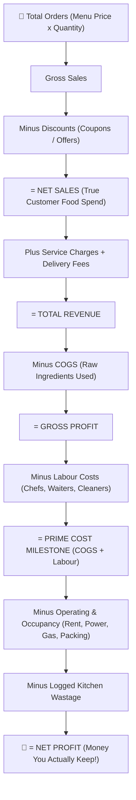
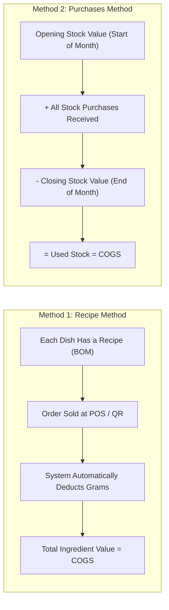
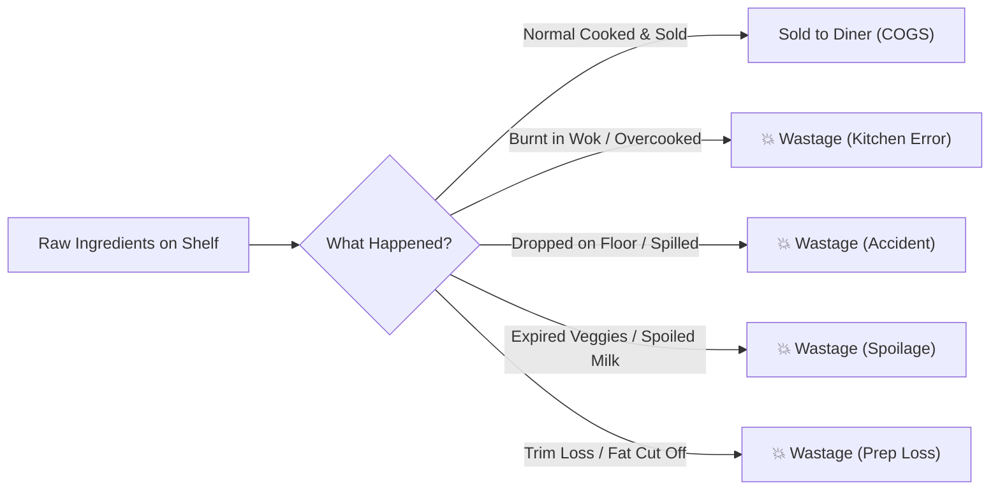
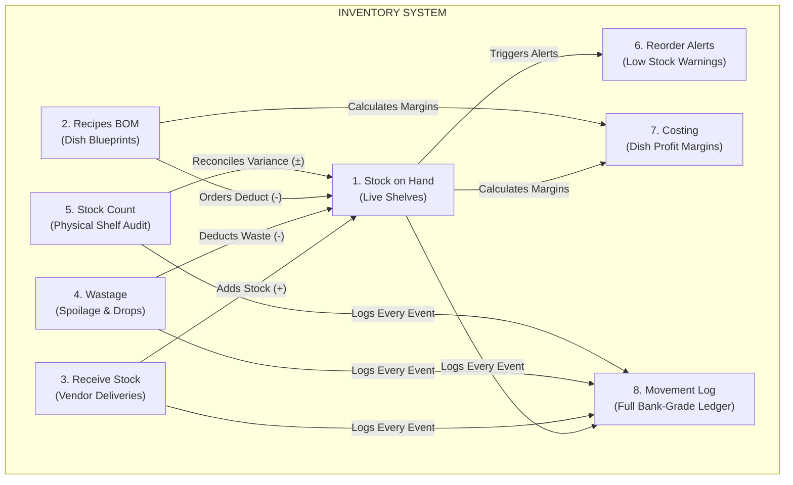
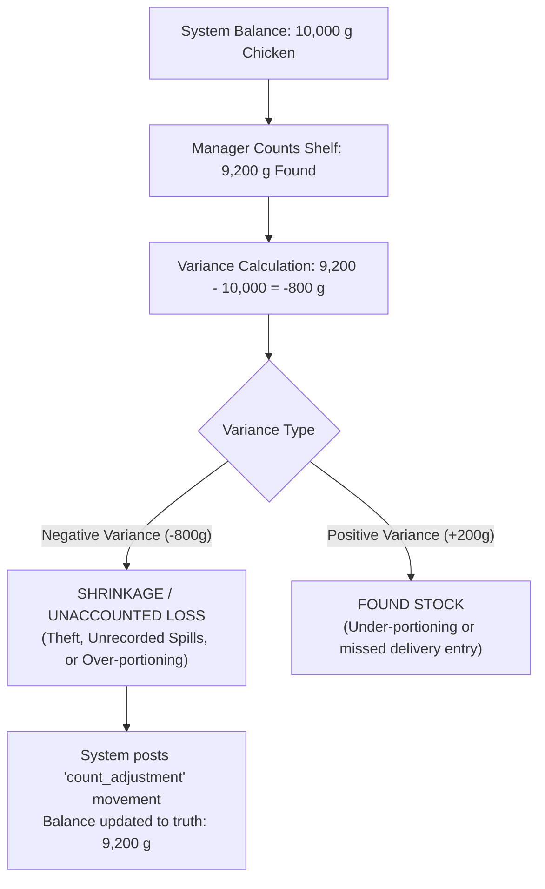

# 🍜 WokMawa Restaurant Management Guide
## Explaining Profit & Loss (P&L), Inventory Management, and Waste Calculation Like You're in High School!

Welcome! If accounting words like **COGS**, **Depreciation**, **Variance**, and **Prime Cost** sound like a foreign language, don't worry. 

Think of **WokMawa** like the ultimate noodle shop. You buy raw noodles, chicken, veggies, and sauces; your chefs fire up the woks; happy customers pay for tasty bowls; and at the end of the month, you want to know: **"Did we actually make money, or did we lose money?"**

This guide breaks down the exact math, logic, and systems running inside the WokMawa software in plain, crystal-clear English with visual diagrams and real-life examples.

---

## 📑 Table of Contents
1. [The Big Picture: How Money Moves in a Restaurant](#1-the-big-picture-how-money-moves-in-a-restaurant)
2. [Section 1: Profit & Loss (P&L) Calculation Explained](#2-section-1-profit--loss-pl-calculation-explained)
   - [The Gold Standard Restaurant P&L Equation](#the-gold-standard-restaurant-pl-equation)
   - [The Golden Rule: Why GST is NOT Revenue](#the-golden-rule-why-gst-is-not-revenue)
   - [What is COGS? (Two Methods Explained)](#what-is-cogs-cost-of-goods-sold)
   - [What is Prime Cost? (The #1 Number Every Owner Watches)](#what-is-prime-cost)
   - [Industry Health Benchmarks (Good vs Bad)](#industry-health-benchmarks)
3. [Section 2: Waste Calculation Explained](#3-section-2-waste-calculation-explained)
   - [What Counts as Waste?](#what-counts-as-waste)
   - [How Rupee Loss is Calculated](#how-rupee-loss-is-calculated)
   - [Why Waste Has Its Own Dedicated Line on the P&L](#why-waste-has-its-own-dedicated-line)
4. [Section 3: Inventory Management — All 8 Tabs Explained](#4-section-3-inventory-management--all-8-tabs-explained)
   - [Tab 1: Stock on Hand (The Digital Shelf)](#tab-1-stock-on-hand-items)
   - [Tab 2: Recipes / BOM (The Recipe Blueprint)](#tab-2-recipes--bom-bill-of-materials)
   - [Tab 3: Receive Stock (Deliveries & Vendor Packs)](#tab-3-receive-stock-purchases)
   - [Tab 4: Wastage (Logging Damaged & Spoiled Food)](#tab-4-wastage-tab)
   - [Tab 5: Stock Count (The Physical Audit)](#tab-5-stock-count-audit)
   - [Tab 6: Reorder Alerts (Never Run Out of Chicken!)](#tab-6-reorder-alerts-low)
   - [Tab 7: Costing (Dish Margins & Food Cost %)](#tab-7-dish-costing--margins)
   - [Tab 8: Movement Log (The Immutable Stock Bank Statement)](#tab-8-movement-log-audit-ledger)
5. [Complete End-to-End Walkthrough (A Day in WokMawa)](#5-complete-end-to-end-walkthrough-a-day-in-wokmawa)

---

## 1. The Big Picture: How Money Moves in a Restaurant

Imagine your noodle shop had a giant clear glass jar on the counter. Every time a customer pays, money goes into the jar. But as the day goes on, money comes out to pay for raw chicken, chef wages, electricity, rent, and broken bowls. Whatever is left in the jar at the end of the month is your **Net Profit**.

Here is how WokMawa tracks every single rupee:



---

## 2. Section 1: Profit & Loss (P&L) Calculation Explained

### The Gold Standard Restaurant P&L Equation

Restaurant accounting is different from an IT company or a retail store. In a restaurant, your biggest costs are **food** and **people**. WokMawa uses the world-standard restaurant accounting ladder:

| Line Item | Plain English Meaning | Example (One Day) |
| :--- | :--- | :--- |
| **Gross Sales** | The full menu price of all food ordered | ₹50,000 |
| **- Discounts** | Coupons or special discounts given to customers | - ₹5,000 |
| **= NET SALES** | **The real money customers spent on your food** | **= ₹45,000** |
| **+ Service Charge** | The restaurant's dine-in service fee | + ₹2,250 |
| **+ Delivery Fee** | Fees charged to deliver parcels | + ₹750 |
| **= TOTAL REVENUE** | **Total money collected that belongs to the business** | **= ₹48,000** |
| **- COGS** | Cost of raw ingredients (rice, chicken, sauces, oil) | - ₹14,400 *(32% of Net Sales)* |
| **= GROSS PROFIT** | Money left after paying for raw food | **= ₹33,600** *(70% Gross Margin)* |
| **- Labour** | Salaries of chefs, kitchen helpers, and service team | - ₹13,500 *(30% of Net Sales)* |
| **- Operating & Rent** | Shop rent, electricity bill, LPG gas cylinders, napkins | - ₹9,000 |
| **- Kitchen Wastage** | Food burnt, dropped on floor, or expired | - ₹1,200 |
| **= NET PROFIT** | **Your actual profit before income tax** | **= ₹9,900** *(20.6% Net Margin)* |

---

### The Golden Rule: Why GST is NOT Revenue!

> [!IMPORTANT]
> **A common rookie mistake:** Counting GST (Goods & Services Tax) as income.
> 
> When a customer buys a bowl of Hakka Noodles for ₹200 and pays 5% GST (₹10), they hand you **₹210**. 
> - **₹200** belongs to WokMawa.
> - **₹10** does **NOT** belong to you! You are just holding it for the Government tax department.
>
> In WokMawa's backend code (`utils/pnl.js`), **GST is never included in Net Sales or Revenue**. It is tracked separately under **Tax Liability** so the owner is never fooled into thinking they have more profit than they really do.

---

### What is COGS? (Cost of Goods Sold)

**COGS** is the cost of the raw stuff that walked out the door in your customers' stomachs. If you sell a plate of Chilli Chicken for ₹250, but the chicken pieces, garlic, bell pepper, and sauces cost you ₹75 to buy, your **COGS** for that plate is **₹75**.

In WokMawa, you can calculate COGS using **two methods**:



#### 1. Recipe Method (Real-Time Consumption)
- **How it works:** Every time an order for *"Kung Pao Chicken"* is marked `completed` or `preparing`, the computer looks up the exact grams of chicken, peanuts, soy sauce, and chilli paste from the recipe and tallies the cost.
- **Pros:** Ultra-precise, shows dish-by-dish margin.
- **Requirement:** Dishes must have recipes entered in the system. If you only entered recipes for 10 out of 50 dishes, the system will give you a warning: *"Only 20% of dishes have recipes, so COGS is understated."*

#### 2. Purchases Method (The Stock Take Formula)
- **The Classic Formula:**
  $$\text{COGS} = \text{Opening Stock} + \text{New Purchases} - \text{Closing Stock}$$
- **Example:**
  - On Oct 1st, you had **₹50,000** worth of groceries on the shelves.
  - During October, you bought **₹1,00,000** more from suppliers.
  - On Oct 31st, you counted the shelves and found **₹40,000** left.
  - $\text{COGS} = ₹50,000 + ₹1,00,000 - ₹40,000 = \mathbf{₹1,10,000}$.
- **Pros:** Works even if you haven't typed in recipes for every single dish yet!

---

### What is Prime Cost?

In the restaurant industry, **Prime Cost** is the ultimate heartbeat metric:

$$\text{Prime Cost} = \text{COGS (Food Cost)} + \text{Labour Cost (Staff Wages)}$$

Why? Because you can't easily change your rent or your electricity rates tomorrow, but **you can control what food you buy and how you schedule your kitchen staff!**

---

### Industry Health Benchmarks

WokMawa colors your metrics automatically so you know immediately if your restaurant is healthy:

| Metric | Formula | Good Range 🟢 | Warning Range 🟡 | Danger Zone 🔴 |
| :--- | :--- | :--- | :--- | :--- |
| **Food Cost %** | $\frac{\text{COGS}}{\text{Net Sales}} \times 100$ | Under 30% | 30% - 35% | Above 35% *(Losing money on ingredients)* |
| **Labour %** | $\frac{\text{Labour}}{\text{Net Sales}} \times 100$ | Under 30% | 30% - 35% | Above 35% *(Overstaffed for current sales)* |
| **Prime Cost %** | $\frac{\text{COGS} + \text{Labour}}{\text{Net Sales}} \times 100$ | Under 60% | 60% - 65% | Above 65% *(Restaurant will struggle to survive)* |
| **Net Margin %** | $\frac{\text{Net Profit}}{\text{Total Revenue}} \times 100$ | Above 10% | 3% - 10% | Below 3% or Negative *(Operating at a loss)* |

---

## 3. Section 2: Waste Calculation Explained

### What Counts as Waste?

In a busy kitchen, food gets wasted every day. But if you don't measure it, money is quietly leaking into the garbage can.



WokMawa provides 5 standard waste classifications:
1. **`spoiled`**: Veggies rotted, paneer went sour, meat unfrozen too long.
2. **`dropped`**: Plate slipped from waiter's hand, container spilled.
3. **`expired`**: Sauces or dairy reached "use by" date before being consumed.
4. **`overcooked`**: Chef scorched the fried rice or put 5x too much salt.
5. **`prep_waste`**: Cutting excess meat fat or trimming veggies beyond normal prep standards.

---

### How Rupee Loss is Calculated

When a chef burns 400g of diced chicken breast:
1. The manager opens the **Wastage** tab in WokMawa.
2. Selects item: **Chicken Breast**.
3. Enters quantity: **400 g** (or 0.4 kg).
4. System looks up the current purchase cost per unit:
   $$\text{Cost per gram} = \frac{₹250}{1000\text{g}} = ₹0.25\text{ per gram}$$
5. System instantly computes the exact financial loss:
   $$\text{Loss} = 400\text{g} \times ₹0.25 = \mathbf{₹100}$$
6. **Double action happens instantly:**
   - **400g is removed from your digital inventory** so your stock records stay truthful.
   - **₹100 is logged under Today's Wastage Loss**.

---

### Why Waste Has Its Own Dedicated Line on the P&L!

> [!TIP]
> **Why not just bundle waste inside COGS?**
> If you hide waste inside general food costs, the chef can just say: *"Oh, food costs are high because vegetables got expensive this week!"*
> 
> By keeping **Wastage on its own standalone line on the P&L**, the restaurant owner can open the dashboard and say:
> *"Wait, why did we throw away ₹4,800 worth of chicken this week? Let's check who worked the evening shift and retrain them."*
> **What gets measured gets managed!**

---

## 4. Section 3: Inventory Management — All 8 Tabs Explained

The WokMawa Inventory section is divided into 8 interconnected tabs that handle everything from raw vegetables to dish profit margins.



---

### Tab 1: Stock on Hand (`items`)
**The Digital Mirror of Your Storeroom.**
- **Base Units:** Everything in WokMawa is tracked in one of 3 fundamental base units:
  - **`g`** (Grams) for solids (rice, chicken, flour, noodles, onions).
  - **`ml`** (Millilitres) for liquids (soy sauce, vinegar, cooking oil, milk).
  - **`pcs`** (Pieces) for countables (takeaway noodle boxes, burger buns, beverage cans).
- **No Manual Cheating:** You cannot simply type over the stock quantity in this table! The only way stock changes is through an actual operational event (Receive Delivery, Cook an Order, Record Waste, or Run an Audit Count).
- **What You See:** Item code, Item Name, Category, In Stock balance, Reorder Level threshold, Cost per Unit, and Total Value of stock sitting on your shelf.

---

### Tab 2: Recipes / BOM (Bill of Materials)
**The Cooking Blueprint That Connects Menu Dishes to Raw Ingredients.**

When a customer orders a dish, how does the computer know what was used? The Recipe / BOM!

#### Example: 1 Plate of Chicken Schezwan Fried Rice
| Ingredient | Quantity Required | Cost per Base Unit | Sub-Cost |
| :--- | :--- | :--- | :--- |
| Basmati Rice (Cooked) | 220 g | ₹0.06 / g | ₹13.20 |
| Boneless Chicken | 90 g | ₹0.28 / g | ₹25.20 |
| Schezwan Sauce | 40 ml | ₹0.20 / ml | ₹8.00 |
| Chopped Spring Onions & Bell Peppers | 50 g | ₹0.08 / g | ₹4.00 |
| Cooking Oil | 25 ml | ₹0.14 / ml | ₹3.50 |
| Takeaway 750ml Container *(if parcel/takeaway)* | 1 pcs | ₹4.50 / pcs | ₹4.50 |
| **Total Recipe Ingredient Cost** | | | **₹58.40** |

If you sell this plate for **₹220**, your ingredient food cost is:
$$\frac{₹58.40}{₹220} \times 100 = \mathbf{26.5\%} \quad \text{(Fantastic margin! 🟢)}$$

---

### Tab 3: Receive Stock (`purchases`)
**When the Supplier's Truck Arrives at the Back Door.**

Suppliers don't sell you 150 grams of chicken or 25 millilitres of soy sauce. They sell in bulk packs:
- A **5 kg** bag of rice.
- A **15-litre** tin of refined sunflower oil.
- A **box of 500** noodle containers.

WokMawa's Receive Stock tab has a smart **Pack-to-Base Unit Converter**:
1. You select **"Refined Oil (15L Tin)"**.
2. You enter: Received **2 Tins** at **₹2,100 per tin**.
3. The system automatically converts this to:
   $$2 \times 15{,}000\text{ ml} = \mathbf{30{,}000\text{ ml added to Stock on Hand}}$$
4. The system updates the cost per millilitre:
   $$\frac{₹2{,}100}{15{,}000\text{ ml}} = \mathbf{₹0.14\text{ per ml}}$$
5. A `purchase` movement is recorded in the ledger with date, invoice number, and vendor name.

---

### Tab 4: Wastage Tab
**Tracking the Leaks in the Bucket.**
- Staff log any item that cannot be served to a customer.
- Dropdown reasons: `spoiled`, `dropped`, `expired`, `overcooked`, `prep_waste`.
- Records who authorized the write-off (staff user ID).
- Feeds straight into the P&L as a direct deduction against gross profit.

---

### Tab 5: Stock Count (Audit & Physical Reconciliation)
**Trust, But Verify.**

At the end of every week or month, the manager walks into the kitchen with a clipboard or tablet and counts what is *actually* sitting on the shelves.



If the system says you should have 10 kg of paneer, but you only count 9 kg, **1 kg went missing**. This is called **shrinkage**. WokMawa records a `count_adjustment` movement so the computer matches real-life reality.

---

### Tab 6: Reorder Alerts (`low`)
**The "Never Run Out of Food" Engine.**

Imagine it's Friday night 8:00 PM, restaurant is full, and the head chef yells: *"We ran out of noodles!"* That's a disaster.

WokMawa prevents this using **Lead Time & Reorder Levels**:
- **Reorder Level:** Minimum quantity below which you must place a new order.
- **Lead Time Days:** How many days the supplier takes to deliver after you call them (e.g., 2 days).
- **Suggested Order Quantity:** Automatically calculates how much to buy so you have enough stock until the next delivery arrives plus a buffer!

Items below reorder level glow **yellow 🟡**, and out-of-stock items glow **red 🔴**.

---

### Tab 7: Dish Costing & Margins (`costing`)
**The Profitability Microscope.**

This tab lists every single item on your menu and breaks down:
1. **Selling Price** (e.g. ₹280)
2. **Recipe Cost** (e.g. ₹70)
3. **Gross Margin (₹)** = $₹280 - ₹70 = \mathbf{₹210}$
4. **Food Cost %** = $\frac{₹70}{₹280} \times 100 = \mathbf{25\%}$

It categorizes dishes into:
- 🌟 **Stars (High Profit, High Popularity):** Promote these dishes!
- 🧩 **Puzzles (High Profit, Low Popularity):** Train staff to recommend them.
- 🐴 **Workhorses (Low Profit, High Popularity):** Slightly raise the price or tweak the recipe portion.
- 🪨 **Dogs (Low Profit, Low Popularity):** Consider removing them from the menu.

---

### Tab 8: Movement Log (Audit Ledger)
**The Bank Statement of Your Kitchen.**

Every single gram that enters or leaves the kitchen is recorded on an **immutable ledger** (just like your personal bank account statement):

| Date & Time | Item | Type | Quantity | Unit | Balance After | Order / Reason |
| :--- | :--- | :--- | :--- | :--- | :--- | :--- |
| Oct 17, 12:30 PM | Chicken Breast | `purchase` | **+ 10,000** | g | 14,500 g | Vendor PO #1082 |
| Oct 17, 01:15 PM | Chicken Breast | `sale` | **- 180** | g | 14,320 g | Order #WM-401 |
| Oct 17, 01:42 PM | Chicken Breast | `sale` | **- 270** | g | 14,050 g | Order #WM-405 |
| Oct 17, 03:00 PM | Chicken Breast | `wastage` | **- 400** | g | 13,650 g | Burnt during prep |
| Oct 17, 11:30 PM | Chicken Breast | `count_adjustment` | **- 150** | g | 13,500 g | Night audit variance |

If a chef claims *"I don't know where the butter went!"*, the owner opens the Movement Log and can see every exact transaction with timestamp, user ID, and reason.

---

## 5. Complete End-to-End Walkthrough (A Day in WokMawa)

Let's put everything together with a quick, fun story:

### 🌞 Morning: 10:00 AM (Stock Arrival)
- Vendor truck delivers **20 kg of Chicken Breast** and **50 kg of Hakka Noodles**.
- Kitchen manager opens **Tab 3 (Receive Stock)** and inputs the invoice.
- **Tab 1 (Stock on Hand)** instantly updates: Chicken goes from 2 kg to 22 kg!

### 🍽️ Lunch Rush: 1:30 PM (Customer Orders)
- Table 4 scans the QR code on `user.wokmawa.com` and orders **2x Chicken Hakka Noodles**.
- The order is accepted and cooked.
- The system checks **Tab 2 (Recipes)**:
  - Deducts $2 \times 150\text{g} = \mathbf{300\text{g}}$ noodles.
  - Deducts $2 \times 80\text{g} = \mathbf{160\text{g}}$ chicken.
- **Tab 8 (Movement Log)** stamps: `Order #WM-512 sale deduction`.

### 💥 Afternoon: 4:00 PM (Kitchen Accident)
- A line cook accidentally burns a batch of fried wontons (worth ₹180 in raw materials).
- The chef logs it in **Tab 4 (Wastage)** with reason: `overcooked`.
- The ingredients are removed from shelf inventory, and ₹180 is added to the day's waste tally.

### 🌙 Night: 11:00 PM (Closing & P&L Statement)
- The owner opens the **Profit & Loss (P&L)** screen on `wokmawa.com/pnl`.
- Here is what the computer calculated in seconds:
  1. **Gross Sales:** ₹62,000
  2. **Discounts Given:** -₹3,000
  3. **Net Sales:** **₹59,000**
  4. **COGS (from Recipe deductions):** -₹17,700 *(30% Food Cost - 🟢 Healthy!)*
  5. **Gross Profit:** **₹41,300**
  6. **Staff Labour Costs:** -₹15,000
  7. **Prime Cost:** ₹32,700 *(55.4% - 🟢 Excellent Control!)*
  8. **Electricity, Rent & Gas for the day:** -₹12,000
  9. **Today's Wastage:** -₹180
  10. **NET PROFIT FOR THE DAY:** **₹14,120 in the owner's pocket!** 🎉

---

## 💡 Summary Cheat Sheet for Reference

```
Gross Sales         (Total menu price of all items ordered)
- Discounts         (Coupons / Promo discounts)
------------------------------------------------------------
= NET SALES         (The foundation number for all restaurant ratios)
+ Service/Delivery  (Restaurant's extra service charges)
------------------------------------------------------------
= TOTAL REVENUE     (Total legitimate income)
- COGS              (Raw groceries used: Opening + Buys - Closing)
------------------------------------------------------------
= GROSS PROFIT      (Income left after grocery costs)
- Labour Costs      (Kitchen & service staff salaries)
------------------------------------------------------------
= (PRIME COST)      (COGS + Labour — Must stay between 55% and 65%!)
- Operating/Rent    (Rent, Electricity, LPG Gas, Cleaning, Marketing)
- Wastage           (Spoiled, burnt, or expired food)
------------------------------------------------------------
= NET PROFIT        (Actual money the restaurant takes home)
```

*(Note: GST is recorded on its own separate tax line and is never treated as company profit).*
